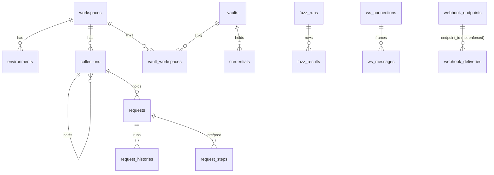

# Database schema (`mitm.db`)

SQLite in WAL mode with foreign keys on, at `<local data dir>/mitm/mitm.db` (`~/.local/share/mitm/mitm.db` on Linux). Migrations are the SQL files in `crates/mitm-core/migrations/`, listed in `src/db/migrations.rs`. They run at startup and are recorded in `_schema_migrations`. A failed migration opens the recovery screen instead of the app.

Bodies and headers are stored as text (headers as JSON arrays of `[name, value]` pairs, so duplicates like `Set-Cookie` survive). The UI loads them per row and never in bulk.

## Tables

| Table | Holds |
| --- | --- |
| `history` | Captured flows. `phase` tracks request/response progress; `is_intercepted`, `is_rewritten` and `is_failed` drive the Traffic flags; `listener_label` names the listener that captured the flow. Pruned by the history limiter when it's on. |
| `intercept_rules` | Interceptor rules in `order_index` order. `action` is `intercept` (whitelist) or `pass` (blacklist). |
| `rewrite_rules` / `rewrite_history` | Rewrite rules (partial edits or full mocks) and the log of rules that fired. |
| `app_preferences` | Key/value settings: `proxy_mode`, `proxy_listeners`, `intercept_enabled`, `intercept_mode`, `intercept_source_scope`, `rewrite_enabled`, `rewrite_source_scope`, `ws_mitm_enabled`, `webhook_port`, `history_limiter_enabled`, `history_limiter_max_rows`, `active_workspace_id`. |
| `workspaces` / `environments` | Workspaces and their environments. Variables and their variants are JSON in `environments.variables_json`. |
| `vaults` / `vault_workspaces` | Vaults hold credentials and link to any number of workspaces, or none. Deleting a vault deletes its credentials; deleting a workspace only removes its links. |
| `credentials` / `credential_keys` | Credentials per vault. Field keys and kinds are plaintext in `fields_json`; values and notes are AES-256-GCM `ciphertext` under the single data key in `credential_keys`, which is stored raw (`kdf` NULL) or wrapped by a master password. |
| `collections` / `requests` | Folder tree and saved requests per workspace. Repeater tabs are `requests` in a hidden workspace (`REPEATER_WORKSPACE_ID`) with its own environment. |
| `request_steps` | Pre/post requests: `request_id` runs `step_request_id` at `position` in the `pre` or `post` phase. |
| `request_histories` | Runs of a saved request or Repeater tab. |
| `fuzz_runs` / `fuzz_results` | Fuzzer runs and their rows. A run is written while it runs with `saved = 0` and dropped on the next start unless it was saved. |
| `ws_connections` / `ws_messages` | WebSocket sessions (proxied or opened by the app, `is_client_session`) and their frames (`is_injected` for frames sent from the composer). |
| `webhook_endpoints` / `webhook_deliveries` | Receiver endpoints and the deliveries they captured, with the signature verdict. |

## Relationships



## Full schema

Generated from a fresh database. To refresh it, open `mitm.db` with `sqlite3` and run `.schema`, or use **Settings ▸ Database**.

```sql
CREATE TABLE _schema_migrations (
            name TEXT PRIMARY KEY,
            executed_at DATETIME DEFAULT CURRENT_TIMESTAMP
        );
CREATE TABLE intercept_rules (
    id TEXT PRIMARY KEY,
    is_enabled INTEGER NOT NULL DEFAULT 1,
    target_phase TEXT NOT NULL,
    match_field TEXT NOT NULL,
    operator TEXT NOT NULL,
    match_value TEXT NOT NULL,
    order_index INTEGER NOT NULL DEFAULT 0,
    created_at_ms INTEGER NOT NULL,
    action TEXT NOT NULL DEFAULT 'intercept'
);
CREATE TABLE app_preferences (
    key TEXT PRIMARY KEY,
    value TEXT NOT NULL
);
CREATE TABLE workspaces (
  id TEXT PRIMARY KEY,
  name TEXT NOT NULL,
  description TEXT,
  active_environment_id TEXT,
  created_at_ms INTEGER NOT NULL,
  updated_at_ms INTEGER NOT NULL
);
CREATE TABLE environments (
  id TEXT PRIMARY KEY,
  workspace_id TEXT NOT NULL,
  name TEXT NOT NULL,
  is_active INTEGER NOT NULL DEFAULT 0,
  variables_json TEXT NOT NULL DEFAULT '[]',
  created_at_ms INTEGER NOT NULL,
  updated_at_ms INTEGER NOT NULL,
  FOREIGN KEY(workspace_id) REFERENCES workspaces(id) ON DELETE CASCADE
);
CREATE TABLE collections (
  id TEXT PRIMARY KEY,
  workspace_id TEXT NOT NULL,
  parent_id TEXT,
  name TEXT NOT NULL,
  description TEXT,
  order_index INTEGER NOT NULL DEFAULT 0,
  created_at_ms INTEGER NOT NULL,
  updated_at_ms INTEGER NOT NULL,
  FOREIGN KEY(workspace_id) REFERENCES workspaces(id) ON DELETE CASCADE,
  FOREIGN KEY(parent_id) REFERENCES collections(id) ON DELETE CASCADE
);
CREATE TABLE requests (
  id TEXT PRIMARY KEY,
  collection_id TEXT NOT NULL,
  name TEXT NOT NULL,
  method TEXT NOT NULL DEFAULT 'GET',
  url TEXT NOT NULL,
  headers_json TEXT NOT NULL DEFAULT '[]',
  params_json TEXT NOT NULL DEFAULT '[]',
  body_type TEXT NOT NULL DEFAULT 'none',
  extract_rules_json TEXT NOT NULL DEFAULT '[]',
  description TEXT,
  order_index INTEGER NOT NULL DEFAULT 0,
  created_at_ms INTEGER NOT NULL,
  updated_at_ms INTEGER NOT NULL, body_json TEXT, body_raw TEXT, body_form_data TEXT, body_urlencoded TEXT,
  FOREIGN KEY(collection_id) REFERENCES collections(id) ON DELETE CASCADE
);
CREATE TABLE request_histories (
  id INTEGER PRIMARY KEY AUTOINCREMENT,
  request_id TEXT NOT NULL,
  method TEXT NOT NULL,
  url TEXT NOT NULL,
  request_headers_json TEXT NOT NULL,
  request_body TEXT,
  status_code INTEGER NOT NULL,
  response_headers_json TEXT NOT NULL,
  response_body TEXT,
  duration_ms INTEGER NOT NULL,
  executed_at_ms INTEGER NOT NULL,
  FOREIGN KEY(request_id) REFERENCES requests(id) ON DELETE CASCADE
);
CREATE TABLE rewrite_rules (
    id TEXT PRIMARY KEY,
    name TEXT NOT NULL,
    enabled INTEGER NOT NULL DEFAULT 1,
    action_type TEXT NOT NULL, -- 'partial_request' | 'full_request' | 'partial_response' | 'full_response'
    
    -- Match Filter
    match_field TEXT NOT NULL DEFAULT 'all', -- 'all' | 'url' | 'host' | 'path' | 'method' | 'header'
    match_operator TEXT NOT NULL DEFAULT 'contains', -- 'contains' | 'equals' | 'regex' | 'starts_with'
    match_value TEXT NOT NULL DEFAULT '',
    
    -- Transformation
    target_part TEXT NOT NULL DEFAULT 'url', -- 'url' | 'query' | 'header' | 'body' | 'method' | 'status'
    target_header TEXT,
    match_pattern TEXT NOT NULL DEFAULT '',
    replacement_value TEXT NOT NULL DEFAULT '',
    is_regex INTEGER NOT NULL DEFAULT 0,
    
    -- Full Mock Response
    mock_status_code INTEGER,
    mock_headers_json TEXT,
    mock_body TEXT,
    
    order_index INTEGER NOT NULL DEFAULT 0,
    created_at_ms INTEGER NOT NULL
);
CREATE INDEX idx_rewrite_rules_order ON rewrite_rules(order_index ASC);
CREATE TABLE webhook_endpoints (
    id TEXT PRIMARY KEY,
    name TEXT NOT NULL,
    path TEXT NOT NULL UNIQUE,
    secret_key TEXT NOT NULL,
    created_at INTEGER NOT NULL,
    hit_count INTEGER NOT NULL DEFAULT 0
);
CREATE TABLE "history" (
    id INTEGER PRIMARY KEY,
    method TEXT NOT NULL,
    url TEXT NOT NULL,
    host TEXT NOT NULL,
    path TEXT NOT NULL DEFAULT '/',
    content_type TEXT NOT NULL DEFAULT '-',
    response_size INTEGER NOT NULL DEFAULT 0,
    status_code INTEGER NOT NULL,
    request_headers TEXT NOT NULL,
    response_headers TEXT NOT NULL,
    request_body TEXT NOT NULL,
    response_body TEXT NOT NULL,
    phase TEXT NOT NULL,
    duration_ms INTEGER,
    created_at DATETIME DEFAULT CURRENT_TIMESTAMP,
    is_intercepted INTEGER NOT NULL DEFAULT 0,
    is_rewritten INTEGER NOT NULL DEFAULT 0,
    is_failed INTEGER NOT NULL DEFAULT 0,
    listener_label TEXT NOT NULL DEFAULT '',
    request_at TEXT,
    response_at TEXT
);
CREATE INDEX idx_history_created_at ON history(created_at DESC);
CREATE INDEX idx_history_method ON history(method);
CREATE INDEX idx_history_status ON history(status_code);
CREATE INDEX idx_history_host ON history(host);
CREATE TABLE "rewrite_history" (
    id INTEGER PRIMARY KEY,
    rule_id TEXT,
    rule_name TEXT NOT NULL,
    action_type TEXT NOT NULL,
    method TEXT NOT NULL,
    original_url TEXT NOT NULL,
    rewritten_url TEXT NOT NULL,
    original_headers TEXT,
    rewritten_headers TEXT,
    original_body TEXT,
    rewritten_body TEXT,
    status_code INTEGER,
    duration_ms INTEGER,
    created_at DATETIME DEFAULT CURRENT_TIMESTAMP
);
CREATE INDEX idx_rewrite_history_created ON rewrite_history(created_at DESC);
CREATE INDEX idx_rewrite_history_rule ON rewrite_history(rule_id);
CREATE TABLE "webhook_deliveries" (
    id INTEGER PRIMARY KEY AUTOINCREMENT,
    endpoint_id TEXT NOT NULL,
    endpoint_path TEXT NOT NULL,
    headers TEXT NOT NULL,
    payload TEXT NOT NULL,
    signature_status TEXT NOT NULL,
    computed_hmac TEXT,
    provided_hmac TEXT,
    timestamp INTEGER NOT NULL
);
CREATE INDEX idx_webhook_deliveries_endpoint ON webhook_deliveries(endpoint_id);
CREATE INDEX idx_webhook_deliveries_timestamp ON webhook_deliveries(timestamp DESC);
CREATE TABLE "ws_connections" (
    id INTEGER PRIMARY KEY AUTOINCREMENT,
    url TEXT NOT NULL,
    status TEXT NOT NULL,
    handshake_time INTEGER NOT NULL,
    closed_at INTEGER,
    protocol TEXT,
    client_addr TEXT,
    is_client_session INTEGER NOT NULL DEFAULT 0,
    message_count INTEGER NOT NULL DEFAULT 0,
    listener_label TEXT NOT NULL DEFAULT ''
);
CREATE TABLE "ws_messages" (
    id INTEGER PRIMARY KEY AUTOINCREMENT,
    connection_id INTEGER NOT NULL,
    direction TEXT NOT NULL,
    msg_type TEXT NOT NULL,
    payload TEXT NOT NULL,
    timestamp INTEGER NOT NULL,
    length INTEGER NOT NULL,
    is_injected INTEGER NOT NULL DEFAULT 0,
    FOREIGN KEY(connection_id) REFERENCES "ws_connections"(id) ON DELETE CASCADE
);
CREATE INDEX idx_ws_connections_handshake_time ON ws_connections(handshake_time DESC);
CREATE INDEX idx_ws_messages_connection_id ON ws_messages(connection_id);
CREATE INDEX idx_ws_messages_timestamp ON ws_messages(timestamp ASC);
CREATE TABLE "fuzz_runs" (
    id            INTEGER PRIMARY KEY,
    name          TEXT NOT NULL,
    attack_type   TEXT NOT NULL,
    config_json   TEXT NOT NULL,
    total         INTEGER NOT NULL DEFAULT 0,
    created_at_ms INTEGER NOT NULL
, saved INTEGER NOT NULL DEFAULT 1);
CREATE TABLE "fuzz_results" (
    id                    INTEGER PRIMARY KEY AUTOINCREMENT,
    run_id                INTEGER NOT NULL,
    idx                   INTEGER NOT NULL,
    payloads_json         TEXT NOT NULL,
    method                TEXT NOT NULL,
    url                   TEXT NOT NULL,
    request_headers_json  TEXT NOT NULL,
    request_body          TEXT,
    status_code           INTEGER NOT NULL,
    response_headers_json TEXT NOT NULL,
    response_body         TEXT,
    response_size         INTEGER NOT NULL DEFAULT 0,
    duration_ms           INTEGER NOT NULL DEFAULT 0,
    error                 TEXT, matches_json TEXT NOT NULL DEFAULT '[]',
    FOREIGN KEY (run_id) REFERENCES "fuzz_runs"(id) ON DELETE CASCADE
);
CREATE INDEX idx_fuzz_results_run ON fuzz_results(run_id, idx);
CREATE TABLE request_steps (
    request_id TEXT NOT NULL REFERENCES requests(id) ON DELETE CASCADE,
    phase TEXT NOT NULL CHECK (phase IN ('pre', 'post')),
    position INTEGER NOT NULL,
    step_request_id TEXT NOT NULL REFERENCES requests(id) ON DELETE CASCADE,
    PRIMARY KEY (request_id, phase, position),
    CHECK (step_request_id != request_id)
);
CREATE INDEX idx_request_steps_step ON request_steps(step_request_id);
CREATE TABLE credential_keys (
    id INTEGER PRIMARY KEY CHECK (id = 1),
    kdf TEXT,
    kdf_params TEXT,
    salt BLOB,
    nonce BLOB,
    wrapped_key BLOB NOT NULL,
    updated_at_ms INTEGER NOT NULL
);
CREATE TABLE vaults (
    id TEXT PRIMARY KEY,
    name TEXT NOT NULL UNIQUE COLLATE NOCASE,
    order_index INTEGER NOT NULL DEFAULT 0,
    created_at_ms INTEGER NOT NULL,
    updated_at_ms INTEGER NOT NULL
);
CREATE TABLE vault_workspaces (
    vault_id TEXT NOT NULL REFERENCES vaults(id) ON DELETE CASCADE,
    workspace_id TEXT NOT NULL REFERENCES workspaces(id) ON DELETE CASCADE,
    PRIMARY KEY (vault_id, workspace_id)
);
CREATE INDEX idx_vault_workspaces_workspace ON vault_workspaces(workspace_id);
CREATE TABLE credentials (
    id TEXT PRIMARY KEY,
    vault_id TEXT NOT NULL REFERENCES vaults(id) ON DELETE CASCADE,
    name TEXT NOT NULL COLLATE NOCASE,
    fields_json TEXT NOT NULL DEFAULT '[]',
    nonce BLOB NOT NULL,
    ciphertext BLOB NOT NULL,
    order_index INTEGER NOT NULL DEFAULT 0,
    created_at_ms INTEGER NOT NULL,
    updated_at_ms INTEGER NOT NULL,
    UNIQUE (vault_id, name)
);
CREATE INDEX idx_credentials_vault ON credentials(vault_id, order_index);
```
